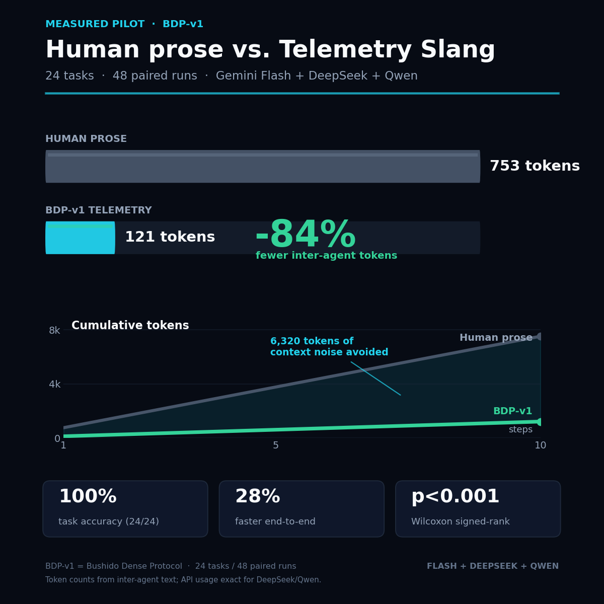

# BDP-v1 Telemetry Pilot

**A measured, paired benchmark of dense key-value telemetry versus human prose between three LLM agents.**

Three models — **Gemini Flash** (orchestrator), **DeepSeek** (strategist), and **Qwen** (verifier) — solve the same 24 bounded engineering decisions twice:

1. **Human prose** — 150–220 word briefings, analyses, and reviews.
2. **BDP-v1 telemetry** — compact key-value packets (≤45 / ≤110 / ≤70 tokens).

The only variable is the handoff format. The tasks, models, and answer key are identical.

## Headline result

| Metric | Human prose | BDP-v1 telemetry | Delta |
|---|---:|---:|---:|
| Mean inter-agent tokens | **753.3** | **121.2** | **−83.8%** |
| Median per-task reduction | — | — | **84.16%** |
| 95% bootstrap CI | — | — | **83.0% – 84.6%** |
| Accuracy | **24/24** | **24/24** | **0 loss** |
| Schema compliance | n/a | **24/24** | 100% |
| Mean end-to-end latency | **197.7 s** | **141.5 s** | **−28.4%** |
| Wilcoxon signed-rank | — | — | **p ≈ 1.19e-07** |

**24 tasks. 48 paired runs. Every task improved (range 78.3%–87.0%).**



## What is BDP-v1?

BDP-v1 (Bushido Dense Protocol v1) is a wire format for inter-agent communication. Human language is kept at the two edges; between the models, only structured telemetry crosses the wire.

**Front door — human to spec:**

```text
BDP:v1|INTENT:CODE_SYNTH|TGT:ring_buffer|REQ:BOUNDS_SAFE+NULL_GUARD|GATE:ASAN_CLEAN
```

**Internal bus — strategist to verifier:**

```text
<think>Ring buffer full when the next head would collide with tail.</think>
BDP:v1|NODE:STRATEGIST|VOTE:B|ROOT_CAUSE:head/tail collision|VERIFY:full check
```

**Back door — verified result to human language:**

The winning result is translated back into a clean human answer with an execution receipt.

### The Anti-Rush scratchpad

The key design constraint is that **thinking and speaking are separated**:

- Every agent gets an isolated `<think>...</think>` scratchpad.
- The scratchpad is governed by a hard instruction: *"Compress the syntax, never the reasoning. Verify bounds, edge cases and failure modes before emitting the telemetry vector."*
- The scratchpad stays local. Only the dense packet crosses the wire.

Without this, forcing short answers makes models rush and skip edge cases. In an earlier long-form test, removing the schema caused the model to loop.

## Experimental design

- **24 tasks** across memory safety, crypto, auth, databases, concurrency, reliability, caching, TLS, filesystem, web, logging, and API design.
- Each task has three options and one deterministic correct answer.
- **Two conditions per task**, paired by task:
  - `prose`: orchestrator → strategist → verifier → orchestrator, all in normal prose.
  - `bdp`: orchestrator spec → strategist packet → verifier packet → orchestrator final answer.
- Same models and same task prompts in both conditions.
- **48 total runs** (24 prose + 24 BDP), one run per task per condition.
- Token counts are estimated from the **inter-agent text** with a deterministic estimator (`words + punctuation × 1.15`); API usage is also recorded exactly for the HTTP providers.
- Pairwise reduction: `1 − bdp_tokens / prose_tokens` for each task.
- Significance: two-sided Wilcoxon signed-rank test over 24 paired reductions.

## Results

| Task | Category | Prose tokens | BDP tokens | Reduction | Prose ✓ | BDP ✓ | BDP schema |
|---|---|---:|---:|---:|:---:|:---:|:---:|
| T01 | memory-safety | 761 | 122 | 84.0% | ✓ | ✓ | ✓ |
| T02 | memory-safety | 734 | 124 | 83.1% | ✓ | ✓ | ✓ |
| T03 | memory-safety | 544 | 118 | 78.3% | ✓ | ✓ | ✓ |
| T04 | http | 762 | 104 | 86.4% | ✓ | ✓ | ✓ |
| T05 | injection | 760 | 107 | 85.9% | ✓ | ✓ | ✓ |
| T06 | crypto | 830 | 124 | 85.1% | ✓ | ✓ | ✓ |
| T07 | auth | 728 | 109 | 85.0% | ✓ | ✓ | ✓ |
| T08 | filesystem | 766 | 132 | 82.8% | ✓ | ✓ | ✓ |
| T09 | crypto | 850 | 121 | 85.8% | ✓ | ✓ | ✓ |
| T10 | api-design | 764 | 115 | 84.9% | ✓ | ✓ | ✓ |
| T11 | web | 753 | 136 | 81.9% | ✓ | ✓ | ✓ |
| T12 | database | 743 | 136 | 81.7% | ✓ | ✓ | ✓ |
| T13 | concurrency | 808 | 105 | 87.0% | ✓ | ✓ | ✓ |
| T14 | reliability | 697 | 116 | 83.4% | ✓ | ✓ | ✓ |
| T15 | caching | 748 | 110 | 85.3% | ✓ | ✓ | ✓ |
| T16 | database | 779 | 115 | 85.2% | ✓ | ✓ | ✓ |
| T17 | unicode | 771 | 105 | 86.4% | ✓ | ✓ | ✓ |
| T18 | logging | 681 | 114 | 83.3% | ✓ | ✓ | ✓ |
| T19 | web | 825 | 128 | 84.5% | ✓ | ✓ | ✓ |
| T20 | filesystem | 742 | 125 | 83.2% | ✓ | ✓ | ✓ |
| T21 | database | 807 | 119 | 85.3% | ✓ | ✓ | ✓ |
| T22 | reliability | 744 | 141 | 81.0% | ✓ | ✓ | ✓ |
| T23 | tls | 717 | 112 | 84.4% | ✓ | ✓ | ✓ |
| T24 | logging | 765 | 136 | 82.2% | ✓ | ✓ | ✓ |

## Reproduce

### Requirements

- Python 3.9+
- `numpy` and `scipy` for the summary statistics
- A Gemini Flash CLI command that accepts a prompt as its final argument
- API keys for DeepSeek and Qwen (OpenAI-compatible endpoints)

```bash
pip install -r requirements.txt
```

### Environment

```bash
export GEMINI_CMD="gemini -m gemini-3.8-flash-high -p"
export DEEPSEEK_API_KEY="..."
export DEEPSEEK_BASE_URL="https://api.deepseek.com/v1"
export DEEPSEEK_MODEL="deepseek-chat"
export QWEN_API_KEY="..."
export QWEN_BASE_URL="https://your-qwen-compatible-endpoint/v1"
export QWEN_MODEL="qwen3.8-max"
```

`GEMINI_CMD` can point to any wrapper that prints the model response to stdout. For example, a script that calls a hosted Flash endpoint works too.

### Run

```bash
python benchmark/run_benchmark.py --tasks 24 --runs 1 --workers 4
```

Use `--resume` to continue an interrupted run.

### Inspect

```bash
cat results/summary.json
column -s, -t results/per_task.csv
```

## Data dictionary

| File | Description |
|---|---|
| `results/runs.jsonl` | One JSON record per run. Includes the full inter-agent messages, token estimate, character counts, final answer, correctness, schema flag, latency, API usage, and errors. |
| `results/runs.csv` | Flat run table. |
| `results/per_task.csv` | Paired prose-vs-BDP table with per-task reduction. |
| `results/summary.json` | Aggregate statistics. |
| `results/summary.md` | Human-readable summary. |
| `results/run.log` | Progress log from the original run. |
| `benchmark/tasks.json` | The 24 tasks, options, and answer key. |
| `benchmark/run_benchmark.py` | Portable reproduction harness. |

## Data hygiene

- **3 of 24 Flash spec calls** returned `error: interrupted` (agent-runtime interruption, not a protocol failure). The strategist/verifier packets and final answers were still correct; the 3 affected runs were re-executed cleanly. The published results use the clean re-runs.
- One prose answer was initially missed by the parser because the raw string was `FINAL: Berror: interrupted`; the answer was correct (B). The parser was made permissive and the record re-scored. Published accuracy is 24/24 for both conditions.
- No API errors, refusals, or empty final answers in the published set.

## Limitations

- The task set is **bounded, single-answer engineering decisions**. A 24/24 ceiling on both conditions supports "no accuracy loss on this set", not a claim about open-ended reasoning.
- Token counts are **text estimates** for the inter-agent messages. The reduction ratio is robust because the same estimator is used in both conditions; exact API usage is recorded for DeepSeek and Qwen.
- End-to-end latency is dominated by model startup and API variance. The 28% difference is a real measurement from this run, not a controlled latency benchmark.
- The protocol requires a strict output schema. Removing the schema and asking for a long-form code artifact caused a loop in an earlier test.

## Ethical note

All tasks are defensive security and software-engineering decisions: input validation, memory safety, authentication, TLS, logging, and reliability. The benchmark contains no exploit payloads, no target data, and no credentials.

## License

MIT — see [LICENSE](LICENSE).
